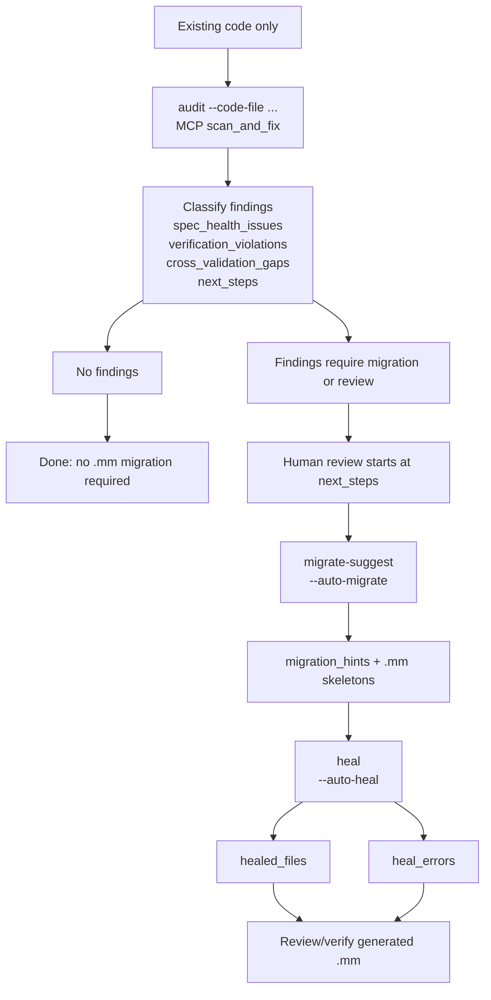

# Audit Contract Reference

## Cross-project harness vocabulary

`mumei-lang/mumei/docs/CROSS_PROJECT_ROADMAP.md` is the single top-level roadmap. Agent docs and MCP contracts use the same canonical field names: `harness_contract`, `intent_fidelity`, `artifact_paths`, `budget_policy_fingerprint`, and `lean_verified`. Audit/spec tooling additionally uses the stable audit keys `spec_health_issues`, `verification_violations`, `verification_status`, `cross_validation_gaps`, `next_steps`, `migration_hints`, `healed_files`, `heal_errors`, and `trusted_atoms`, plus `contradiction_type` values `spec_internal`, `spec_overconstraint`, `spec_vacuity`, and `spec_vs_code`; do not introduce aliases in README, CLI help, or MCP tool descriptions.

`uv run mumei-agent audit --code-file ... --auto-migrate --auto-heal` and MCP `scan_and_fix` are the same no-`.mm` contract: `audit` emits `spec_health_issues` / `verification_violations` / `verification_status` / `cross_validation_gaps` / `next_steps`, `migrate-suggest` emits `migration_hints`, and `heal` records `healed_files` / `heal_errors`.

## No-.mm entry: one audit contract

`uv run mumei-agent audit --code-file ... --auto-migrate --auto-heal` and MCP `scan_and_fix` are the same contract. They both run the same three-stage path:

1. `audit`: accept existing code only, extract candidate specs, and classify findings.
2. `migrate-suggest` / `--auto-migrate`: emit `.mm` skeleton guidance only for findings that need migration.
3. `heal` / `--auto-heal`: run self-healing on those generated skeletons and report the outcome.

Canonical result keys are fixed as follows:

Language support is split into two layers:

| Layer | Scope | Supported languages |
|-------|-------|---------------------|
| Layer A (spec extraction) | `extract-spec --code-file`, `extract_spec_from_code` MCP, LLM/regex-based NL spec extraction | `rust`, `c`, `cpp`, `go`, `python`, `javascript`, `typescript`, `java`, `solidity` |
| Layer B (Z3 strict verification) | `validate-code`, `validate-spec-to-code`, `validate-code-to-spec`, `audit`, `scan_and_fix` MCP | `python`, `rust`, `typescript`, `go`, `solidity` |

Layer A uses LLM and regex heuristics to extract natural-language specifications from code. Layer B uses Z3 SMT solver and deterministic foreign-code parsers for strict contract verification. Languages supported only by Layer A (c, cpp, java, javascript) can be used for spec extraction but will receive an informative error if passed to Layer B tools.

`audit`, `validate-code`, `validate-spec-to-code`, `validate-code-to-spec`, and MCP `scan_and_fix` use the same fixed keys for all five Layer B languages; Rust overflow/bounds findings, TypeScript null/undefined findings, Go bounds/nil/overflow findings, and Solidity `uint256`/`int256` overflow and array-bounds findings appear in `verification_violations` with Z3 counterexamples when the deterministic parser can prove an unsafe path. Solidity support covers function-level pre/postconditions and 256-bit overflow/bounds; Layer B also emits advisory heuristic warnings for reentrancy / Checks-Effects-Interactions and missing access control, backed by a guard-state-machine trace and suppressed when `nonReentrant`/manual-lock guards are present. The missing-access-control warning is also skipped for a function that only acts for the caller — it indexes state by `msg.sender`, passes `msg.sender` as an argument, pays `msg.sender`, or uses `msg.value` (an `emit` argument does not count). The guard-trace certificate's access-control obligations stay `unknown` for verification purposes by default; `audit --enable-lean-bridge --mumei-lean-repo <path>` runs the optional mumei-lean bridge (`run_lean_bridge_and_merge_proof_cert`) that merges `lean_verified` results into the emitted proof certificate. The flag only applies to Solidity audits and is a no-op without `--mumei-lean-repo`; it is CLI-only today — MCP `scan_and_fix` does not expose it. LLM credentials are optional: when no key is configured, the deterministic parser still extracts signatures, safety preconditions, and postcondition candidates.

By default Layer B checks each extracted contract against a `trusted` atom with an empty body, so the function body itself is never verified. `audit --enable-body-port` adds that check: the LLM translates each function body to Mumei as written, and mumei verifies the translation against the extracted contract, with the file's other atoms as trusted callees. Each atom gets a `body_ports` entry with `function`, `outcome` (`proven`, `refuted`, `inconclusive` or `not_ported`), `reason`, `body` and any `counterexample`. A `refuted` port adds a `body-port:` line to `verification_violations` and sets the status to `refuted`. Treat it as evidence to check against the native code, because the translation can differ from the original. The LLM sees only the function's source, its pinned signature and contract, and the other atoms. Its reply may supply only the body: replies that declare atoms, import modules or restate a contract are recorded as `not_ported`. Go and Rust ports are verified with `mumei verify --check-i64-overflow`, because their native integers are 64-bit: a body `+`, `-` or `*` that can leave the range of its integer type refutes the port, while the contract keeps unbounded arithmetic. Unsigned parameters (`u8`…`usize`, `uint`…`uintptr`, `byte`) are pinned as `u64`, and mumei checks an operation on them against the `u64` range instead, so `x - 1` on a `uint` refutes at `0` and a function that mixes `x: i64` and `tag: u8` still checks `x + 1` against `i64`. A Rust function with a 128-bit integer (`u128`, `i128`) in its signature is verified unbounded. Python, TypeScript and Solidity ports keep unbounded integers. The entry's `integer_semantics` is `i64` or `unbounded`; a mumei that does not know the flag is retried without it and records `unbounded`. Without LLM credentials every file records a single `not_ported` entry. The flag is CLI-only; MCP `scan_and_fix` does not expose it. Before the source goes to the LLM, and before the returned body, diagnostics and counterexamples are written to `body_ports`, `agent/secret_redaction.py` replaces the values of environment variables registered as sensitive, provider token formats (AWS, GitHub, OpenAI-style `sk-`, Slack, Google API keys, JWTs, private-key blocks) and string literals assigned to credential-like names (`password`, `secret`, `token`, `api_key`, ...) with `<redacted>`. The redaction is pattern-based, so a credential that matches none of these shapes still goes through; review such code before enabling the flag.

`audit --enable-native-replay` checks findings against the native code. For each extracted atom whose parameters are integers, booleans or integer arrays and whose result is an integer or a boolean, it calls the real Python, TypeScript, Go or Rust function on the body-port and foreign-verifier counterexamples, then fills up to twelve inputs in all with boundary inputs (each parameter at 0, 1, -1, 2, 7, 100 and -100 with the others at zero); counterexamples come first, so a function with twelve of them gets no boundary inputs. It then pins the inputs and the native result into an atom with the extracted contract and asks mumei whether the result meets it. Each run gets a `native_replays` entry with `function`, `input`, `source` (`body_port`, `counterexample` or `boundary`), `native`, `verdict` and `reason`. A `violates` verdict adds a `native-replay:` line to `verification_violations` and is counted in `finding_counts["confirmed"]`, a subset of `code`. A refuted body port whose counterexample the native code meets is marked `native_replay: not_reproduced` and its `body-port:` finding is dropped; a proven port whose function violates the contract natively is marked `port_mismatch`. `raised` means the native code threw on an input the contract admits, and is reported without failing the audit. Boundary inputs outside `requires` are left out. The harnesses are fixed templates run on a temporary copy of the file (Python and TypeScript), the Go module or the Cargo crate; Rust runs in release mode, so integer overflow wraps as in a shipped binary. Methods, generics and other parameter types are recorded as `unsupported`. Sensitive environment values are redacted from `native_replays` and the findings, numbers included, and a native exception is recorded by its type name only. The flag executes the audited code on the local machine, so only enable it for code you would run. It is CLI-only.

| Key | Meaning |
| --- | --- |
| `spec_health_issues` | Spec-only contradictions, overconstraints, vacuity, or ambiguity in extracted/provided specs; these do not require existing-code execution to be meaningful. |
| `verification_violations` | Existing-code bugs or unsafe paths found before `.mm` migration by checking inferred/extracted contracts against the source. |
| `verification_status` | Machine-readable code-safety verdict for the audited source: `verified`, `refuted`, or `unverifiable`. |
| `cross_validation_gaps` | Spec↔code mismatches: missing constraints, stronger/weaker behavior, or cross-spec drift that still needs migration or review. |
| `next_steps` | The human-review entrypoint: prioritized actions and commands reviewers should run before accepting migration or healing evidence. |
| `migration_hints` | `.mm` skeleton advice produced by `migrate-suggest` / `--auto-migrate` for functions attached to violations or gaps. |
| `healed_files` | Generated `.mm` skeleton files that the self-healing loop rewrote or accepted successfully. |
| `heal_errors` | Per-skeleton self-healing failures and diagnostics; these never change the meaning of the audit findings. |
| `trusted_atoms` | Advisory findings (severity `warning`, each with `file`/`atom`/`line`) for every `trusted atom` declaration found in `.mm` sources under the audited path — trusted atoms bypass Z3 verification, so an audit must surface them instead of passing silently. They never land in `errors` and never flip `success` or `files_with_issues` on their own. |



Use the one-command CLI form when you want audit, skeleton generation, and healing evidence together:

```bash
uv run mumei-agent audit --code-file src/ --auto-migrate --auto-heal --heal-output-dir out/
```

MCP clients call the same contract with `scan_and_fix`:

```json
{
  "code_file": "src/",
  "language": "python",
  "auto_heal": true,
  "heal_output_dir": "out/"
}
```

`next_steps` is the only handoff into human review. Do not add aliases for `spec_health_issues`, `verification_violations`, `cross_validation_gaps`, `next_steps`, `migration_hints`, `healed_files`, `heal_errors`, or `trusted_atoms`; downstream docs, MCP responses, and demo JSON should consume those names exactly.

Within `spec_health_issues`, entries prefixed `domain-completeness:` come from the domain checklist that runs when `audit --domain-hint <d>` (or `validate-spec --domain`/`--domain-hint`) is used — e.g. `domain-completeness: financial spec lacks balance conservation (…; expected in ensures)`. They follow the same prefix convention as `contradiction:` / `over-constrained:` / `vacuous:` / `encoding-gap:` and are findings, not a new output key. Similarly, `validate-code` issues carry a `fix_suggestion` field inside each existing violation object — a heuristic text hint per finding kind, never an applied edit. When the violation has a usable `source_line` and the message names the offending expression, the hint appends a `Suggested diff` fenced block showing the contract/guard line to add above the flagged signature (`requires: <condition>` contract comments for bounds/division/overflow/dereference kinds, `nonReentrant` / `require(msg.sender == owner, …)` edits for the Solidity advisory kinds); otherwise the field holds the text hint alone. The domain completeness check also runs for `extract-spec --domain <d>` (warnings on stderr) and MCP `extract_spec_from_code` with `domain_hint` (appended to the file-mode `warnings` list) — no new output keys in either path.

Language-pattern advisories (V1-B-2, `agent/language_patterns.py`) add heuristic "common problem" findings — e.g. Python mutable default arguments, Rust unguarded `unwrap()`, Go `defer` inside loops, TypeScript floating promises, Solidity `tx.origin`/`selfdestruct`/unchecked low-level `call`/`delegatecall`/`send`/`staticcall`. They surface only on the warnings side: `verify` reports them inside `warnings`, and `validate-code` emits them as `severity="warning"` `verification` issues (demoted to `warnings` on `verified` results, with phrase-routed `fix_suggestion` hints). They never land in `errors`, so they cannot flip `success` on their own. `audit` does not emit them today — its output vocabulary is fixed.

`audit` separates findings about the code from findings about the extracted spec. `finding_counts` counts each level: `code` (`verification_violations`), `spec` (`spec_health_issues` other than `encoding-gap:` entries, plus `cross_validation_gaps`), `model_limitations` (`encoding-gap:` entries, spec clauses mumei could not encode) and `errors`. Only code findings, errors and `malformed-extraction:` entries (the code was never checked) set `success` to false and count toward `files_with_issues`. Spec diagnostics are still listed in full, but they show up as "passed with N spec diagnostics to review" and in `files_with_spec_diagnostics`, because an LLM-extracted spec that disagrees with the code is not evidence that the code is wrong.

For manual review, run the same stages separately:

```bash
uv run mumei-agent audit --code-file src/foo.py --language python
uv run mumei-agent migrate-suggest --code-file src/foo.py --language python --output generated/mm
uv run mumei-agent heal generated/mm/foo.mm
```

Demo wording for no-`.mm` user-facing material is fixed to these three phrases:

1. 既存コードを渡すだけでバグ箇所を指摘
2. 仕様から既存コードとの差分を指摘
3. 仕様単独でおかしい場合を指摘
