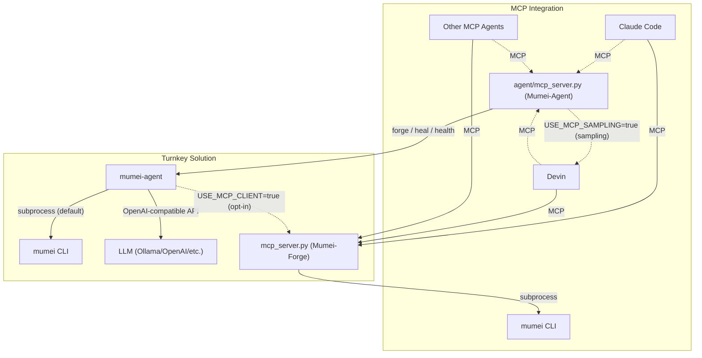

# MCP Server Reference

> Canonical cross-server contract: [mumei `docs/MCP_TOOL_CONTRACT.md`](https://github.com/mumei-lang/mumei/blob/develop/docs/MCP_TOOL_CONTRACT.md) is authoritative for both MCP servers. This document is subordinate to that contract and provides the agent-server detail.

## Relationship with MCP Server / Other AI Agents

**mumei-agent** is a turnkey solution — it integrates LLM calls, `mumei verify`, and retry logic into a single autonomous fix loop. It invokes the mumei CLI directly via subprocess (no MCP required).

The [mumei](https://github.com/mumei-lang/mumei) compiler repository also ships an **MCP Server** (`mcp_server.py`, implemented as FastMCP("Mumei-Forge")), which allows any MCP-compatible AI agent (Claude Code, Devin, Codex, Qwen, etc.) to access mumei's verification capabilities directly over the Model Context Protocol. The agent MCP server complements that with proof-friendly specification guidance so clients can request decidable-fragment hints before generating contracts.



By default, `agent/mcp_server.py` uses the same OpenAI-compatible LLM endpoint
as the CLI. Set `USE_MCP_SAMPLING=true` to make all LLM-backed MCP tools request
completion through standard MCP sampling from the connected client instead, so
Devin or another MCP client supplies the LLM role without `LLM_API_KEY` being
configured in mumei-agent. If the client does not support sampling, or sampling
fails, the agent falls back to the OpenAI-compatible path.

See [`docs/AGENT_HARNESS_SPEC.md`](./AGENT_HARNESS_SPEC.md) § *MCP sampling
provider* for the sampling-capable tool list, the MCP 2025-11-25 spec mapping,
and capability-detection details. The `mumei/mcp_server.py` **Mumei-Forge**
server remains verification-only; sampling is implemented only in `mumei-agent`
so the forge/heal loop is not duplicated in the compiler repository.

### When to Use Which

- **mumei-agent**: Run `uv run mumei-agent file.mm` for a fully automated fix loop. LLM provider is configured via `.env` (Ollama, OpenAI, DashScope, etc.). Best when you want a single-command experience.
- **MCP Server**: Start `python mcp_server.py` in the [mumei repository](https://github.com/mumei-lang/mumei) and connect from any MCP-compatible agent. The agent calls tools like `validate_logic`, `forge_blade`, and `get_inferred_effects`, and uses its own LLM to decide how to fix issues. Best when you already use an MCP-capable agent and want to integrate mumei verification into your existing workflow.

Both approaches are **complementary** — choose based on your use case, or combine them as needed.

## MCP Server

`uv run mumei-agent mcp-server` runs mumei-agent as a `FastMCP("Mumei-Agent")`
server over stdio.  Any MCP-compatible client (Claude Code, Devin,
Codex, ...) can drive the same forge loop that the CLI exposes.

Exported tools:

| Tool | Description |
|---|---|
| `approve_review(atom_name, reviewer, notes)` | Record human approval for one atom in the active review queue; requires `get_review_queue` first, fails if the atom is `REJECTED` or `ESCALATED_TO_LEAN` |
| `async_send_latent_message(message, context='{}', verify=true)` | Asynchronously send a single latent message through one protocol instance |
| `audit_code(source_code, language, domain_hint='')` | Audit existing code: extract spec, verify contracts, detect cross-validation gaps |
| `check_cross_spec_consistency(spec_files)` | Run cross-spec verification for a JSON array or comma-separated list of `.mm` files and return cross-validation evidence |
| `check_spec_contradiction(natural_language, domain_hint='')` | Extract a natural-language spec and return `contradiction_type=spec_internal` for direct contradictions without code generation |
| `check_spec_health(source_code, mumei_repo='')` | Check a Mumei spec for contradictions, over-constraints, and vacuity |
| `cross_validate(spec_file, impl_file, language='')` | Cross-validate a Mumei spec (.mm) against its implementation code |
| `escalate_to_lean(atom_name)` | Run `mumei verify --escalate-lean` and mark an atom as escalated; requires `get_review_queue` first, fails if the atom is `APPROVED` or `REJECTED` |
| `extract_spec(natural_language, domain_hint='', generate=false, mumei_repo='', check_contradiction_only=false)` | Extract a forge spec, optionally generate code, or run contradiction-only validation |
| `extract_spec_from_code(code_file, language='', domain_hint='', generate=false, mumei_repo='')` | Extract natural-language specification from existing code (Layer A) |
| `forge_task(task_json, mumei_repo, dry_run=true)` | Run a single forge spec (drop-in `MumeiForge.forge_one`) |
| `evidence_check_accept(sequence_json, check_json)` | Restore a declared attempt-sequence snapshot and evidence-check record from inline JSON and emit the `mumei.evidence-check-acceptance/v1` descriptor — `accepted` only when the record binds the sequence's current candidate and is `"valid"`; no Core run, representation-level only |
| `evidence_compare(evidence_a_path, evidence_b_path)` | Compare two declared `mumei.verification-evidence/v1` records' claim surfaces and emit `mumei.evidence-comparison/v1` (`subject_match`/`specification_match`/`claims_match`); record-vs-record comparison only, no Core run |
| `evidence_identity_check(evidence_path, source_path)` | Compare a declared `mumei.verification-evidence/v1` record's bound `subject.sha256` to the current source bytes and emit `mumei.evidence-file-identity/v1` (`match`/`mismatch`); byte-level file identity only, no Core run |
| `evidence_producer_check(evidence_path, tool, adapter_id, tool_version='', adapter_version='')` | Compare a declared `mumei.verification-evidence/v1` record's `provenance` block to declared producer expectations and emit `mumei.evidence-producer-identity/v1` (`match`/`mismatch` + `mismatched` fields); representation-level producer pinning only, no Core run |
| `evidence_check(core_path, evidence_path, attempt_timeout_ms=30000)` | Feed a declared `mumei.verification-evidence/v1` record's bytes to `evidence check --stdin --json` as one declared attempt (same wiring as the `evidence-check` route) and return `mumei.evidence-check-report/v1` — `representation` is claimed only on the recognised v1 diagnostic |
| `verify_attempt(core_path, source_path, solver_timeout_ms=5000, solver_resource_limit=1000000, attempt_timeout_ms=30000)` | Run `evidence verify-source` as one declared attempt (same wiring as the `verify-attempt` route) and return `mumei.verify-attempt-report/v1` — including `candidate`, `evidence_check` and `acceptance` when a result is selected; a selected run reports `claim_truth` + `file_identity` + `freshness` + `producer_authenticity` + `semantic_correspondence` in `discharged_checks`; representation-level acceptance only |
| `verify_recheck(core_path, evidence_path, source_path, solver_timeout_ms=5000, solver_resource_limit=1000000, attempt_timeout_ms=30000)` | Run `evidence recheck-source` as one declared attempt (same wiring as `verify-recheck`); `recheck` is claimed only for uniquely-mapped exit codes and mid-run drift reports `inputs_changed`; a `consistent` recheck reports `claim_truth` + `freshness` + `semantic_correspondence` in `discharged_checks` |
| `native_recheck(core_path, bundle_dir, source_path, expected_build_id, attempt_timeout_ms=30000)` | Run `native-bundle recheck-llvm` as one declared attempt (same wiring as `native-recheck`) and return `mumei.native-recheck-report/v1`; an `equivalent` recheck reports `artifact_semantics` + `claim_truth` in `discharged_checks` |
| `native_attempt(core_path, source_path, bundle_dir, attempt_timeout_ms=60000)` | Run `native-bundle build` as one declared attempt (same wiring as `native-attempt`) and return `mumei.native-attempt-report/v1` — `build_id` + `candidate` only when the produced bundle holds the full declared member set |
| `native_accept(core_path, bundle_dir, source_path, expected_build_id, attempt_timeout_ms=60000)` | Run `native-bundle accept-artifact` as one declared attempt (same wiring as `native-accept`) and return `mumei.native-accept-report/v1` — `acceptance` claimed only for uniquely-mapped exit codes (0 `accepted`, 3 `inconclusive`); an `accepted` run reports `artifact_semantics` + `claim_truth` in `discharged_checks`; the produced descriptor is anonymous, so no `candidate` is emitted |
| `native_evidence_recheck(core_path, bundle_dir, source_path, evidence_path, expected_build_id, attempt_timeout_ms=30000)` | Run `native-bundle recheck-evidence` as one declared attempt (same wiring as `native-evidence-recheck`) and return `mumei.native-evidence-recheck-report/v1` — `evidence_recheck` claimed only for uniquely-mapped exit codes (0 `consistent`, 3 `inconclusive`); a `consistent` run reports `artifact_semantics` + `claim_truth` in `discharged_checks`; consistency is not acceptance |
| `native_evidence_accept(core_path, bundle_dir, source_path, evidence_path, expected_build_id, attempt_timeout_ms=30000)` | Run `native-bundle accept-evidence --json` as one declared attempt (same wiring as `native-evidence-accept`) and return `mumei.native-evidence-accept-report/v1` — `acceptance` claimed only for uniquely-mapped exit codes (0 `accepted`, 3 `inconclusive`); an `accepted` run reports `artifact_semantics` + `claim_truth` in `discharged_checks`; the produced descriptor is anonymous, so no `candidate` is emitted |
| `summaries_plan(profile, stamp, tool_version='', histories_path='', rounds=1, max_parallel=1)` | Plan the summary route for a declared profile through the C11 probe boundary (same wiring as `summaries-plan`) and return the `mumei.summaries-plan/v1` document — a selected adapter is a routing decision, not an accepted manifest |
| `ts_summaries(source_path, resolve_modules=false)` | Emit the `mumei.ts-scalar-parameter-deps/v1` manifest for one declared source under the 64 KiB bound (same wiring as `ts-summaries`); optional relative-import resolution — a conservative report, not a proof |
| `rust_summaries(source_path, resolve_modules=false)` | Emit the `mumei.rust-scalar-parameter-deps/v1` manifest for one declared source under the 64 KiB bound (same wiring as `rust-summaries`); optional relative-import resolution — a conservative report, not a proof |
| `sol_summaries(source_path, resolve_modules=false)` | Emit the `mumei.sol-scalar-parameter-deps/v1` manifest for one declared source under the 256 KiB bound (same wiring as `sol-summaries`); optional relative-import resolution — a conservative report, not a proof |
| `ts_summaries_check(source_path, manifest_path, resolve_modules=false)` | Compare a declared `mumei.ts-scalar-parameter-deps/v1` manifest against a fresh derivation (same wiring as `ts-summaries-check`) and return `mumei.ts-summary-check/v1` (`context_match` + `reusable`/`stale`/`missing`); detection only |
| `rust_summaries_check(source_path, manifest_path, resolve_modules=false)` | Same wiring as `rust-summaries-check` — returns `mumei.rust-summary-check/v1` |
| `sol_summaries_check(source_path, manifest_path, resolve_modules=false)` | Same wiring as `sol-summaries-check` — returns `mumei.sol-summary-check/v1` |
| `ts_summaries_reuse(source_path, manifest_path, resolve_modules=false)` | Emit a merged `mumei.ts-scalar-parameter-deps/v1` manifest reusing the declared manifest's unchanged summaries (same wiring as `ts-summaries-reuse`) — the weaker per-function freshness merge, not the strict gate |
| `rust_summaries_reuse(source_path, manifest_path, resolve_modules=false)` | Same wiring as `rust-summaries-reuse` — returns the merged `mumei.rust-scalar-parameter-deps/v1` manifest |
| `sol_summaries_reuse(source_path, manifest_path, resolve_modules=false)` | Same wiring as `sol-summaries-reuse` — returns the merged `mumei.sol-scalar-parameter-deps/v1` manifest |
| `ts_summaries_accept(source_path, manifest_path, function, resolve_modules=false)` | Run the strict whole-context accept gate for one declared TS function (same wiring as `ts-summaries-accept`) — returns `mumei.ts-summary-accept/v1`; the freshly derived record, never the declared one |
| `rust_summaries_accept(source_path, manifest_path, function, resolve_modules=false)` | Same wiring as `rust-summaries-accept` — returns `mumei.rust-summary-accept/v1`; exact name or bare-member-name resolution |
| `sol_summaries_accept(source_path, manifest_path, function, resolve_modules=false)` | Same wiring as `sol-summaries-accept` — returns `mumei.sol-summary-accept/v1`; exact name or bare-member-name resolution |
| `ts_summaries_attempt(source_path, attempt_timeout_ms, memory_bound_mb=0)` | Run the `ts-summaries` produce route as one declared attempt (same wiring as `ts-summaries-attempt`) — returns `mumei.ts-summaries-attempt-report/v1`: canonical lineage, not an accepted manifest |
| `rust_summaries_attempt(source_path, attempt_timeout_ms, memory_bound_mb=0)` | Same wiring as `rust-summaries-attempt` — returns `mumei.rust-summaries-attempt-report/v1` |
| `sol_summaries_attempt(source_path, attempt_timeout_ms, memory_bound_mb=0)` | Same wiring as `sol-summaries-attempt` — returns `mumei.sol-summaries-attempt-report/v1` |
| `get_agent_status(ctx)` | Report LLM provider, mumei binary, available subcommands, registered MCP tools, and connected MCP client capabilities |
| `get_review_queue(mumei_repo)` | Return the human review queue emitted by `mumei verify` for an existing `mumei_repo` directory that contains `human_review_queue.json`, and set the active tracker for `approve_review` / `reject_review` / `escalate_to_lean` |
| `get_spec_guide_summary()` | Return the agent-facing decidable-fragment guideline summary |
| `go_summaries(source_files, go_types, target_arch='amd64', imports_json='{}', timeout_s=30)` | Emit a declared `mumei.go-scalar-parameter-deps/v1` summary manifest via a provisioned go-types helper; every byte is declared by the caller (files, import units, helper binary) — a conservative report, not a proof |
| `go_summaries_attempt(source_files, go_types, attempt_timeout_ms, target_arch='amd64', imports_json='{}', timeout_s=30, memory_bound_mb=0)` | Run the `go-summaries` produce route as one declared attempt (same wiring as `go-summaries-attempt`) — returns `mumei.go-summaries-attempt-report/v1`: canonical lineage, not an accepted manifest |
| `go_summaries_check(source_files, go_types, manifest_path, target_arch='amd64', imports_json='{}', timeout_s=30)` | Run the manifest reuse check for declared Go summaries (same wiring as `go-summaries-check`) — returns `mumei.go-summary-check/v1`: `context_match` plus `reusable`/`stale`/`missing` |
| `go_summaries_reuse(source_files, go_types, manifest_path, target_arch='amd64', imports_json='{}', timeout_s=30)` | Emit a merged manifest reusing a declared manifest's unchanged Go summaries (same wiring as `go-summaries-reuse`) — per-function freshness merge, keyed to the fresh context |
| `go_summaries_accept(source_files, go_types, manifest_path, binding, target_arch='amd64', imports_json='{}', timeout_s=30)` | Accept one declared Go summary under the strict whole-set gate (same wiring as `go-summaries-accept`) — returns `mumei.go-summary-accept/v1` with the freshly derived record |
| `get_spec_guidelines()` | Return proof-friendly generation guidance for the Z3-stable decidable fragment and Lean escalation candidates |
| `heal_file(source_code='', error_report='', code_file='')` | Self-heal a `.mm` source via the existing fix-strategy pipeline |
| `list_forge_log(log_path='forge_log.json')` | Read `forge_log.json` |
| `measure_std_health(mumei_repo)` | Delegate to `agent.std_health.measure_health` |
| `propose_forge_tasks(mumei_repo, max_proposals=3)` | MCP-accessible `uv run mumei-agent propose --auto` |
| `reject_review(atom_name, reviewer, notes)` | Record human rejection for one atom in the active review queue; requires `get_review_queue` first, fails if the atom is `ESCALATED_TO_LEAN` |
| `run_nlae_pipeline(spec, mumei_lean_repo='', work_dir='', no_build=false)` | Run the P9-G NLAE pipeline: generate `.mm`, verify with `--emit loss-vector`, self-correct, then call the Lean Fidelity Checker |
| `scan_and_fix(code_file, language, spec='', auto_heal=false, heal_output_dir='', domain_hint='', output_format='json')` | Same contract as `audit --code-file ... --auto-migrate --auto-heal`: audit a file/directory, return `cross_validation_gaps`, emit `migration_hints`, optionally self-heal |
| `self_correct(code_file, max_iterations=10)` | Run the P9-F Loss Vector self-correction loop for a `.mm` file |
| `send_latent_message(message, context='{}', verify=true)` | Send a single latent message through one protocol instance |
| `send_latent_message_batch(messages, verify=false)` | Send multiple latent messages through one protocol instance |
| `suggest_mm_migration(code_file, language, issues_json='[]')` | Generate `.mm` migration skeleton for functions with verification issues |
| `validate_code(code, language, use_llm=true, run_mumei=true)` | Infer and verify contracts from existing code (Layer B: Python, Rust, TypeScript, Go) |
| `validate_code_to_spec(code_path, spec_path, language=None, use_llm=true, run_mumei=true)` | Detect spec drift by comparing changed code to spec |
| `validate_foreign_code(code, language, use_llm=true, run_mumei=true)` | Infer and verify contracts from foreign code (alias for `validate_code`) |
| `validate_nl_spec(spec_text, use_llm=true, run_mumei=true, domain_hint='')` | Validate a natural-language spec for contradictions, ambiguity, and over-constraint |
| `validate_nl_spec_multi(spec_texts_json, domain_hint='', use_llm=true)` | Validate multiple natural-language specs in one call |
| `validate_spec_to_code(spec, code_path, language=None, use_llm=true, run_mumei=true)` | Detect missing implementation constraints by comparing spec to code |
| `verify_code_spec_traceability(code_file, spec_text, language=None, use_llm=true, run_mumei=true)` | Return the V1-C/V1-D bidirectional traceability summary with `cross_validation_gaps`, `drift_score`, and `next_steps` |
| `verify_conformance(spec, code_path, language=None, use_llm=true, run_mumei=true)` | Return the V1-C conformance JSON with `next_steps` and no review aliases |
| `verify_foreign_code(source_code, language, use_llm=true, run_mumei=true)` | Z3 strict verification of foreign code contracts |

## Canonical contract table

This generated table is the agent-side view of the cross-server contract. The
mumei `docs/MCP_TOOL_CONTRACT.md` table remains canonical.

| Tool | Arguments | Documented return keys |
| --- | --- | --- |
| `get_spec_guide_summary` |  |  |
| `get_spec_guidelines` |  |  |
| `forge_task` | `task_json: str, mumei_repo: str, dry_run: bool = True, ctx: Context \| None = None` | `task_id`, `status`, `target_file`, `error`, `code_length` |
| `heal_file` | `source_code: str = '', error_report: str = '', code_file: str = '', ctx: Context \| None = None` | `healed_code`, `attempts`, `success`, `error` |
| `self_correct` | `code_file: str, max_iterations: int = 10, ctx: Context \| None = None` |  |
| `run_nlae_pipeline` | `spec: str, mumei_lean_repo: str = '', work_dir: str = '', no_build: bool = False, multi_agent: bool = False` |  |
| `measure_std_health` | `mumei_repo: str` | `total_files`, `verified_files`, `failed_files`, `total_atoms`, `verified_atoms`, `trusted_atoms`, `health_score`, `todo_count`, `details` |
| `cross_validate` | `spec_file: str, impl_file: str, language: str = ''` | `spec_stronger_than_impl`, `impl_stronger_than_spec`, `uncovered_atoms`, `coverage_ratio`, `details` |
| `propose_forge_tasks` | `mumei_repo: str, max_proposals: int = 3` | `proposals`, `specs` |
| `list_forge_log` | `log_path: str = 'forge_log.json'` | `entries`, `count` |
| `get_review_queue` | `mumei_repo: str` |  |
| `approve_review` | `atom_name: str, reviewer: str, notes: str` |  |
| `escalate_to_lean` | `atom_name: str` |  |
| `reject_review` | `atom_name: str, reviewer: str, notes: str` |  |
| `get_agent_status` | `ctx: Context \| None = None` |  |
| `send_latent_message` | `message: str, context: str = '{}', verify: bool = True` |  |
| `send_latent_message_batch` | `messages: str, verify: bool = False` |  |
| `async_send_latent_message` | `message: str, context: str = '{}', verify: bool = True` |  |
| `extract_spec` | `natural_language: str, domain_hint: str = '', generate: bool = False, mumei_repo: str = '', check_contradiction_only: bool = False, ctx: Context \| None = None` | `spec`, `code`, `verified` |
| `check_spec_contradiction` | `natural_language: str, domain_hint: str = '', ctx: Context \| None = None` |  |
| `check_cross_spec_consistency` | `spec_files: str` |  |
| `check_spec_health` | `source_code: str, mumei_repo: str = ''` | `contradictions`, `over_constrained`, `vacuous`, `health_score` |
| `validate_nl_spec` | `spec_text: str, use_llm: bool = True, run_mumei: bool = True, domain_hint: str = '', ctx: Context \| None = None` |  |
| `validate_nl_spec_multi` | `spec_texts_json: str, domain_hint: str = '', use_llm: bool = True, ctx: Context \| None = None` |  |
| `validate_code` | `code: str, language: str, use_llm: bool = True, run_mumei: bool = True, ctx: Context \| None = None` |  |
| `validate_foreign_code` | `code: str, language: str, use_llm: bool = True, run_mumei: bool = True, ctx: Context \| None = None` |  |
| `validate_spec_to_code` | `spec: str, code_path: str, language: str \| None = None, use_llm: bool = True, run_mumei: bool = True, ctx: Context \| None = None` |  |
| `validate_code_to_spec` | `code_path: str, spec_path: str, language: str \| None = None, use_llm: bool = True, run_mumei: bool = True, ctx: Context \| None = None` |  |
| `verify_attempt` | `core_path: str, source_path: str, solver_timeout_ms: int = 5000, solver_resource_limit: int = 1000000, attempt_timeout_ms: int = 30000` | `report` |
| `verify_conformance` | `spec: str, code_path: str, language: str \| None = None, use_llm: bool = True, run_mumei: bool = True, ctx: Context \| None = None` |  |
| `verify_recheck` | `core_path: str, evidence_path: str, source_path: str, solver_timeout_ms: int = 5000, solver_resource_limit: int = 1000000, attempt_timeout_ms: int = 30000` | `report` |
| `verify_code_spec_traceability` | `code_file: str, spec_text: str, language: str \| None = None, use_llm: bool = True, run_mumei: bool = True, ctx: Context \| None = None` |  |
| `verify_foreign_code` | `source_code: str, language: str, use_llm: bool = True, run_mumei: bool = True, ctx: Context \| None = None` |  |
| `audit_code` | `source_code: str, language: str, domain_hint: str = '', ctx: Context \| None = None` |  |
| `evidence_check` | `core_path: str, evidence_path: str, attempt_timeout_ms: int = 30000` | `report` |
| `evidence_check_accept` | `sequence_json: str, check_json: str` | `acceptance` |
| `evidence_compare` | `evidence_a_path: str, evidence_b_path: str` | `comparison` |
| `evidence_identity_check` | `evidence_path: str, source_path: str` | `identity` |
| `evidence_producer_check` | `evidence_path: str, tool: str, adapter_id: str, tool_version: str = '', adapter_version: str = ''` | `identity` |
| `native_recheck` | `core_path: str, bundle_dir: str, source_path: str, expected_build_id: str, attempt_timeout_ms: int = 30000` | `report` |
| `native_attempt` | `core_path: str, source_path: str, bundle_dir: str, attempt_timeout_ms: int = 60000` | `report` |
| `native_accept` | `core_path: str, bundle_dir: str, source_path: str, expected_build_id: str, attempt_timeout_ms: int = 60000` | `report` |
| `native_evidence_recheck` | `core_path: str, bundle_dir: str, source_path: str, evidence_path: str, expected_build_id: str, attempt_timeout_ms: int = 30000` | `report` |
| `native_evidence_accept` | `core_path: str, bundle_dir: str, source_path: str, evidence_path: str, expected_build_id: str, attempt_timeout_ms: int = 30000` | `report` |
| `summaries_plan` | `profile: str, stamp: int, tool_version: str = '', histories_path: str = '', rounds: int = 1, max_parallel: int = 1` | `plan`, `observations`, `histories` |
| `ts_summaries` | `source_path: str, resolve_modules: bool = False` | `manifest` |
| `rust_summaries` | `source_path: str, resolve_modules: bool = False` | `manifest` |
| `sol_summaries` | `source_path: str, resolve_modules: bool = False` | `manifest` |
| `ts_summaries_check` | `source_path: str, manifest_path: str, resolve_modules: bool = False` | `check` |
| `rust_summaries_check` | `source_path: str, manifest_path: str, resolve_modules: bool = False` | `check` |
| `sol_summaries_check` | `source_path: str, manifest_path: str, resolve_modules: bool = False` | `check` |
| `ts_summaries_reuse` | `source_path: str, manifest_path: str, resolve_modules: bool = False` | `manifest` |
| `rust_summaries_reuse` | `source_path: str, manifest_path: str, resolve_modules: bool = False` | `manifest` |
| `sol_summaries_reuse` | `source_path: str, manifest_path: str, resolve_modules: bool = False` | `manifest` |
| `ts_summaries_accept` | `source_path: str, manifest_path: str, function: str, resolve_modules: bool = False` | `accept` |
| `rust_summaries_accept` | `source_path: str, manifest_path: str, function: str, resolve_modules: bool = False` | `accept` |
| `sol_summaries_accept` | `source_path: str, manifest_path: str, function: str, resolve_modules: bool = False` | `accept` |
| `ts_summaries_attempt` | `source_path: str, attempt_timeout_ms: int, memory_bound_mb: int = 0` | `report` |
| `rust_summaries_attempt` | `source_path: str, attempt_timeout_ms: int, memory_bound_mb: int = 0` | `report` |
| `sol_summaries_attempt` | `source_path: str, attempt_timeout_ms: int, memory_bound_mb: int = 0` | `report` |
| `go_summaries` | `source_files: str, go_types: str, target_arch: str = 'amd64', imports_json: str = '{}', timeout_s: int = 30` | `manifest` |
| `go_summaries_attempt` | `source_files: str, go_types: str, attempt_timeout_ms: int, target_arch: str = 'amd64', imports_json: str = '{}', timeout_s: int = 30, memory_bound_mb: int = 0` | `report` |
| `go_summaries_check` | `source_files: str, go_types: str, manifest_path: str, target_arch: str = 'amd64', imports_json: str = '{}', timeout_s: int = 30` | `check` |
| `go_summaries_reuse` | `source_files: str, go_types: str, manifest_path: str, target_arch: str = 'amd64', imports_json: str = '{}', timeout_s: int = 30` | `manifest` |
| `go_summaries_accept` | `source_files: str, go_types: str, manifest_path: str, binding: str, target_arch: str = 'amd64', imports_json: str = '{}', timeout_s: int = 30` | `accept` |
| `suggest_mm_migration` | `code_file: str, language: str, issues_json: str = '[]'` | `migration_hints` |
| `scan_and_fix` | `code_file: str, language: str, spec: str = '', auto_heal: bool = False, heal_output_dir: str = '', domain_hint: str = '', output_format: str = 'json', ctx: Context \| None = None` | `spec_health_issues`, `verification_violations`, `verification_status`, `cross_validation_gaps`, `next_steps`, `migration_hints`, `healed_files`, `heal_errors` |
| `extract_spec_from_code` | `code_file: str, language: str = '', domain_hint: str = '', generate: bool = False, mumei_repo: str = '', ctx: Context \| None = None` | `spec`, `natural_language_spec`, `detected_language`, `warnings`, `code`, `final_spec`, `verified` |

`check_cross_spec_consistency` delegates to `mumei verify --cross-spec-files` and returns the parsed `cross_spec.json`, including contract consistency, global invariant conflicts, source file names, and dependency cycles. Session-type protocol violations (P22) are surfaced both raw (`session_protocol_violations[]`, `session_analysis_skips[]`) and as `missing_constraints[]` with the declared `contradiction_type` (`spec_vs_code`), following the report's own `agent_artifact_mapping[]`; a violation makes `consistent` false, and so does a non-empty `session_analysis_skips[]` — the compiler's bounded session analysis is fail-open, so a skipped effect leaves consistency unestablished rather than proven. If the report's declared mapping for `session_protocol_violations[]` stops matching the mapping the agent applies, the mismatch is reported in `artifact_mapping_divergences[]` instead of being followed silently.

Example `.mcp.json` snippet for Claude Code project MCP config:

```json
{
  "mcpServers": {
    "mumei-forge": {
      "command": "sh",
      "args": ["-lc", "cd ../mumei && exec python mcp_server.py"]
    },
    "mumei-agent": {
      "command": "sh",
      "args": ["-lc", "cd . && exec uv run mumei-agent mcp-server"]
    }
  }
}
```

The committed `.mcp.json` assumes the mumei compiler repository is checked out
as a sibling directory (`../mumei`).  Adjust that path if your workspace layout
differs.  The config intentionally uses `sh -lc "cd ... && exec ..."` instead
of a `cwd` field because Claude Code project MCP configs are most portable when
the working directory is set by the command itself.

### Proof-friendly specification guidance

`get_spec_guidelines()` exposes the same decidable-fragment guidance injected into generation prompts: prefer linear arithmetic, bounded array/sequence access, bounded quantifiers, and explicit finite temporal states. When a spec triggers `outside_decidable_fragment`, callers should simplify the contract, add explicit bounds or witnesses, or route the obligation to Lean.

P8-C metrics in `agent.metrics.Metrics` track how often new specifications fall outside the decidable fragment (`outside_decidable_fragment_warnings`, `z3_unknowns`, `first_pass_verification_success_rate`, and `by_logic_fragment`) so the guidance can be refreshed quarterly.

### Lean fallback diagnostics

Set `MUMEI_LEAN_REPO=/path/to/mumei-lean` to let `proliferate` escalate
`z3_check_result == "unknown"` atoms through the Lean bridge. The fallback contract matches `mumei-lean`: live-generated theorem path `Generated.Std.Math.Abs.abs_saturating_correct`, known-witness fallback `MumeiLean.StdMathAbs`, and stable failure classes `lake_missing`, `partial_translation`, and `stale_translator`. The fallback now
records retryability, per-error-code failure rates, proof-time distribution, and
partial-success status in the summary JSON. See
[`docs/LEAN_FALLBACK.md`](./LEAN_FALLBACK.md) for error-code meanings and
troubleshooting steps.

### MCP-backed verification (opt-in)

Set `USE_MCP_CLIENT=true` to make forge / heal / proliferate route their
verification through `agent.mcp_client.MumeiMCPClient` instead of the
raw `mumei verify --json` subprocess.  The MCP client returns the
richer semantic feedback the mumei MCP server formats (`semantic_feedback`,
`machine_readable`, `counter_example`, `effect_violation`).  Any failure
falls back to the subprocess client so the agent always works.

The client picks a transport automatically:

- **In-process** when the mumei repo is on `PYTHONPATH` (default in CI).
- **stdio subprocess** when `MUMEI_MCP_COMMAND` is set
  (e.g. `MUMEI_MCP_COMMAND="python /path/to/mumei/mcp_server.py"`).

### Unified gap analysis (`PREFER_MCP_GAPS`)

`agent/gap_rules.py` is the offline copy of the gap-rule logic from the
mumei MCP server's `analyze_std_gaps` tool.  Set `PREFER_MCP_GAPS=true`
(and put the mumei repo on `PYTHONPATH`) to make
`agent.proliferate.analyze_gaps` delegate to the authoritative
implementation in the mumei repo.  `proliferate.yml` already does this
in CI so the rule set is always in lockstep with whatever ships in
mumei.
